<p align="center">
  <a href="https://github.com/AlexSkrypnyk/prompty" rel="noopener">
  </a>
</p>

<h1 align="center">Zero-dependency interactive CLI prompt library for PHP</h1>

<div align="center">

[](https://github.com/alexskrypnyk/prompty/issues)
[](https://github.com/alexskrypnyk/prompty/pulls)
[](https://github.com/alexskrypnyk/prompty/actions/workflows/test-php.yml)
[](https://codecov.io/gh/alexskrypnyk/prompty)


</div>

---

<p align="center">
  
</p>

Prompty asks questions in the terminal for PHP command-line scripts, from a single text prompt to a multi-step wizard. It's 1 file with no dependencies, so you can require it, install it with Composer or embed it in your script. This README is for PHP developers and covers installing Prompty, building prompts and flows, testing them and shipping the script that uses them.

## Features

- 📦 [**Zero dependencies**](#installation) - drop `Prompty.php` into your project or [embed](#embedding) it in your script
- 🧩 [**Widgets**](#widgets) - `text`, `select`, `multiselect` and `confirm`
- 🔀 [**Flows**](#flows) - group prompts into a wizard with an intro, an outro, numbering and cancellation
- 🌳 [**Nested flows**](#nested-flows-with-conditions) - conditional children drawn as a tree
- ⚡ [**Standalone mode**](#standalone-mode) - use any widget on its own, outside a flow
- 🌍 [**Environment variable discovery**](#environment-variable-discovery) - fill answers from environment variables
- 💬 [**Descriptions and hints**](#descriptions-and-hints) - help text under each label and each option
- ✨ [**Unicode and ASCII**](#unicode-and-ascii) - detected from the locale, or forced
- 🎨 [**ANSI colors**](#ansi-colors) - on by default, off under `NO_COLOR` or `TERM=dumb`
- ⚙️ [**Configuration**](#configuration) - symbols, colors, spacing, labels, the variable prefix and the yes/no values
- 🧪 [**Test harness**](#test-harness) - `PromptyTestTrait` feeds keystrokes to widgets in PHPUnit
- 🚀 [**Starter script**](#starter-script) - [`starter.php`](starter.php) as a template for your own scripts
- 📥 [**Embedding**](#embedding) - minify the class and embed it in your script

## Installation

Prompty is a single PHP file with no dependencies. It requires PHP 8.2 or later.

### Download from releases

Download `Prompty.php` from the [latest release](https://github.com/AlexSkrypnyk/prompty/releases/latest) assets.

The release has 3 variants of the class:

| Asset                 | Description                                                             |
|-----------------------|-------------------------------------------------------------------------|
| `Prompty.php`         | Full source with version imprinted                                      |
| `Prompty.min.php`     | Minified - comments except the license header and blank lines stripped, class body on 1 line |
| `Prompty.compact.php` | Minified, plus shortened internal names and no optional whitespace      |

For testing, also download `PromptyTestTrait.php` from the same release.

Each release also ships `Prompty.min.payload` and `Prompty.compact.payload`. Each holds the exact code `embed.php` writes between the markers in that mode. To check an embedded script against them, see [Verify an embedded script](#verify-an-embedded-script).

To embed the class in your script, see [Embedding](#embedding).

### Verifying a download

Every release ships a `SHA256SUMS` file signed with the maintainer's GPG key, and a build attestation for every asset. To check a download with GPG or the GitHub CLI, follow [Verifying a release](SECURITY.md#verifying-a-release) in `SECURITY.md`, which also lists the key's fingerprint.

### Composer

```bash
composer require alexskrypnyk/prompty
```

`PromptyTestTrait` is included in the package.

## Usage

Require the file and use the class directly:

```php
require_once __DIR__ . '/Prompty.php';

use AlexSkrypnyk\Prompty\Prompty;

$dish = Prompty::text('Dish name');
```

To ship a single file instead, [embed](#embedding) the minified class in your script. To start from a template, copy the [starter script](#starter-script).

## Widgets

Prompty has 4 widgets. Each returns the answer, or `null` when the user presses <kbd>Escape</kbd> or <kbd>Ctrl+C</kbd>.

Widgets draw only printable text. A newline or tab in a value, label or option label becomes a space. Escape sequences and other control characters are removed, so a value can't break the tree or control the terminal. `text` returns the same printable text it drew.

<p align="center">
  
</p>

### Text

Free-form text input, with an optional `default` and `placeholder`:

```php
$dish = Prompty::text('Dish name',
  default: 'pear tart',
  placeholder: 'e.g. pear tart',
  description: "Written on the order ticket and under\n"
    . '"Specials" on the board.',
);
```

`default` pre-fills the input with text the user can edit. `placeholder` is the gray text shown while the input is empty.

Submitting an empty input returns the `placeholder` string itself, so a placeholder also works as a fallback answer. With a `default` set, submitting without typing returns the default. To let an empty answer stay empty, leave both unset.

A [discovered](#environment-variable-discovery) value follows the same rule. Prompty trims it, and an empty result takes the `default`, or the `placeholder` when no default is set:

```php
// All 3 answer 'pear tart'.
// Submitted without typing:
Prompty::text('Dish name', placeholder: 'pear tart');
// Discovered as empty or blank:
Prompty::text('Dish name', placeholder: 'pear tart', discovered: '');
Prompty::text('Dish name', placeholder: 'pear tart', discovered: '  ');
```

In a flow with a `dish` step, an empty `PROMPTY_DISH=` takes the fallback without prompting. An unset `PROMPTY_DISH` opens the prompt, where submitting without typing gives the same fallback.

<table>
  <tr>
    <td></td>
    <td align="center"><strong>ANSI</strong></td>
    <td align="center"><strong>No ANSI</strong></td>
  </tr>
  <tr>
    <td align="right"><strong>Unicode</strong></td>
    <td>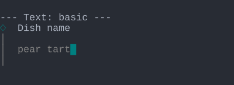</td>
    <td>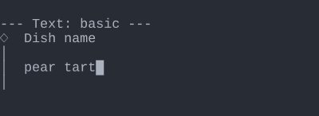</td>
  </tr>
  <tr>
    <td align="right"><strong>ASCII</strong></td>
    <td></td>
    <td></td>
  </tr>
</table>

### Select

Pick 1 option from a list. Press the arrow keys to move and <kbd>Enter</kbd> to confirm. To focus an option other than the first, pass its key as `default`:

```php
$course = Prompty::select('Course',
  options: [
    'starter' => 'Starter',
    'main' => 'Main',
    'dessert' => 'Dessert',
  ],
  default: 'main',
  description: 'Where the dish sits in the meal.',
  hints: [
    'starter' => 'Served first, in a small portion.',
    'main' => 'The centre of the meal.',
    'dessert' => 'Sweet, served last.',
  ],
);
```

`options` must hold at least 1 option. An empty `options` throws an `InvalidArgumentException` before the widget draws anything, even when the answer comes from `discovered` or an environment variable:

```text
No options declared for "Course". Provide at least one option.
```

<table>
  <tr>
    <td></td>
    <td align="center"><strong>ANSI</strong></td>
    <td align="center"><strong>No ANSI</strong></td>
  </tr>
  <tr>
    <td align="right"><strong>Unicode</strong></td>
    <td>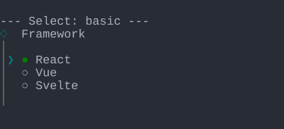</td>
    <td>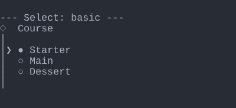</td>
  </tr>
  <tr>
    <td align="right"><strong>ASCII</strong></td>
    <td>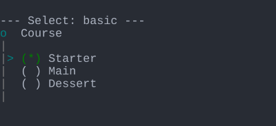</td>
    <td></td>
  </tr>
</table>

### Multiselect

Pick any number of options from a list. Press <kbd>Space</kbd> to toggle an option and <kbd>Enter</kbd> to confirm. To pre-check options, pass a list of their keys as `default`. Pre-checking every option makes an opt-out list:

```php
$extras = Prompty::multiselect('Extras',
  options: [
    'bread' => 'Bread',
    'olives' => 'Olives',
    'herbs' => 'Herbs',
  ],
  default: ['bread', 'olives', 'herbs'],
  description: "Anything served alongside.\n"
    . 'Space to toggle, enter to confirm.',
);
```

As with [select](#select), an empty `options` throws an `InvalidArgumentException` that names the widget.

<table>
  <tr>
    <td></td>
    <td align="center"><strong>ANSI</strong></td>
    <td align="center"><strong>No ANSI</strong></td>
  </tr>
  <tr>
    <td align="right"><strong>Unicode</strong></td>
    <td>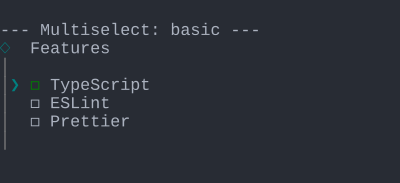</td>
    <td>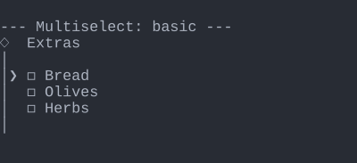</td>
  </tr>
  <tr>
    <td align="right"><strong>ASCII</strong></td>
    <td>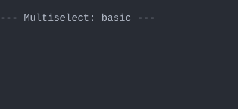</td>
    <td></td>
  </tr>
</table>

### Confirm

A yes/no toggle. Press the arrow keys or <kbd>Tab</kbd> to switch, <kbd>y</kbd> or <kbd>n</kbd> to pick directly and <kbd>Enter</kbd> to confirm:

```php
$send = Prompty::confirm('Send order?',
  description: 'Passes the order to the kitchen.',
);
```

<table>
  <tr>
    <td></td>
    <td align="center"><strong>ANSI</strong></td>
    <td align="center"><strong>No ANSI</strong></td>
  </tr>
  <tr>
    <td align="right"><strong>Unicode</strong></td>
    <td>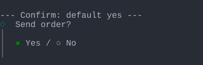</td>
    <td>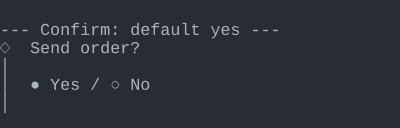</td>
  </tr>
  <tr>
    <td align="right"><strong>ASCII</strong></td>
    <td></td>
    <td>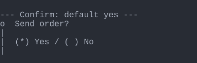</td>
  </tr>
</table>

## Flows

`flow()` groups widgets into a step-by-step wizard. Each array key names a step:

```php
$results = Prompty::flow(fn(): array => [
  'dish' => Prompty::text('Dish name', placeholder: 'pear tart'),
  'course' => Prompty::select('Course', options: [
    'starter' => 'Starter',
    'main' => 'Main',
    'dessert' => 'Dessert',
  ]),
  'extras' => Prompty::multiselect('Extras', options: [
    'bread' => 'Bread',
    'olives' => 'Olives',
    'herbs' => 'Herbs',
  ]),
  'send' => Prompty::confirm('Send order?'),
], intro: 'Compose an order', outro: 'Order sent!');
```

`flow()` returns the answers keyed by step, or `null` when the user cancels any step.

An input stream with nothing left to read counts as a cancellation. A flow run from a pipe, from `/dev/null` or in CI without a terminal returns `null` at the first prompt it can't read.

`intro`, `outro` and `cancelled` each take a string or a callable. A callable receives the answers collected so far:

```php
$results = Prompty::flow(fn(): array => [ /* ... */ ],
  intro: 'Compose an order',
  outro: function (array $results): void {
    echo 'Dish: ' . $results['dish'] . "\n";
  },
  cancelled: 'Order cancelled.',
  numbering: TRUE, // Renders (1), (2), nested as (1.1), (1.2), etc.
);
```

### Nested flows with conditions

Prompty draws a widget's `children` as an indented tree under it, joined by vertical bars. Any step can take a `condition`, which receives the answers collected so far. When the condition returns `false`, the flow skips the step:

```php
$results = Prompty::flow(fn(): array => [
  'course' => Prompty::select('Course',
    options: ['main' => 'Main', 'dessert' => 'Dessert'],
    children: [
      'method' => Prompty::select('Method',
        options: [
          'baked' => 'Baked',
          'poached' => 'Poached',
          'grilled' => 'Grilled',
        ],
        condition: fn($r): bool => ($r['course'] ?? '') === 'main',
      ),
      'finishes' => Prompty::multiselect('Finishes',
        options: [
          'glazed' => 'Glazed',
          'dusted' => 'Dusted',
          'piped' => 'Piped',
        ],
        condition: fn($r): bool => ($r['course'] ?? '') === 'dessert',
      ),
    ],
  ),
]);
```

## Standalone mode

Called outside a flow, a widget sets up the terminal, asks its question and returns the answer:

```php
require_once 'Prompty.php';

use AlexSkrypnyk\Prompty\Prompty;

$dish = Prompty::text('Dish name');
$course = Prompty::select('Course', options: [
  'starter' => 'Starter',
  'main' => 'Main',
]);
$send = Prompty::confirm('Send order?');

echo "Sending $dish for the $course course...\n";
```

A script can mix standalone widgets and flows:

```php
// Standalone widgets can sit between flows.
$dish = Prompty::flow(fn(): array => [/* step 1 */], intro: 'Step 1: The dish');
$note = Prompty::text('Kitchen note');
$extras = Prompty::flow(fn(): array => [/* step 2 */], intro: 'Step 2: Extras');
```

## Environment variable discovery

Inside a flow, each step can take its answer from an environment variable named after the step key, uppercased, with the `PROMPTY_` prefix. A widget called outside a flow reads no variables:

```bash
PROMPTY_DISH='pear tart' PROMPTY_COURSE=main php your-script.php
```

The flow draws `dish` and `course` as completed steps and prompts only for the rest.

To change the prefix for 1 flow, pass `env_prefix`. To change it for every flow, pass it to [`Prompty::configure()`](#configuration):

```php
// Reads KITCHEN_DISH, KITCHEN_COURSE, etc.
$results = Prompty::flow(fn(): array => [/* ... */], env_prefix: 'KITCHEN_');
```

A multiselect reads its variable as a comma-separated list, so `PROMPTY_EXTRAS=bread,olives` selects both options. The result is deduplicated and in declared option order, so `PROMPTY_EXTRAS=olives,bread,olives` also gives `['bread', 'olives']`. A trailing comma is ignored.

Every widget also takes a `discovered:` argument for an answer the script already holds, such as a parsed `--extras=bread,olives` flag. A widget given a `discovered:` value skips its prompt, inside a flow or outside one. In a flow, the `discovered:` value wins over the environment variable.

A multiselect reads a `discovered:` string as a comma-separated list too, so a string from `getopt()` and a list give the same answer:

```php
Prompty::multiselect('Extras',
  options: $extras, discovered: 'bread,olives');
Prompty::multiselect('Extras',
  options: $extras, discovered: ['bread', 'olives']);
```

The list form takes each entry as is. Use it to select an option key that contains a comma.

A confirm matches its value against the `truthy` and `falsy` lists, after trimming and ignoring case. The defaults are `1`, `true` and `yes` for yes, and `0`, `false` and `no` for no, so `YES` and `True` both count as yes. A boolean `discovered:` value is taken as is.

A step key of `dish_name` reads `PROMPTY_DISH_NAME`. A name a shell can export holds only letters, digits and underscores. It doesn't start with a digit. Only a parent process can set a name such as `PROMPTY_DISH-NAME`, as in `env 'PROMPTY_DISH-NAME=x' php your-script.php`. `export` rejects it in bash, zsh and sh. Most `.env` parsers reject it too. `flow()` throws an `InvalidArgumentException` for such a step before the first prompt:

```text
Step "dish-name" is looked up as the environment variable "PROMPTY_DISH-NAME", which cannot be exported. A variable name may hold only letters, digits and underscores, and may not start with a digit.
```

Prompty checks the full variable name, so an `env_prefix` that can't be exported fails the same way. With an empty prefix, a key that starts with a digit fails too.

Each key must also be unique across the whole flow, children included. `flow()` stores every answer in 1 flat array keyed by step, so a reused key would overwrite an earlier answer. `flow()` rejects a reused key before the first prompt:

```text
Step "dish" appears more than once in the flow. Each answer is stored under its step key, so a later step would overwrite the earlier answer in the results.
```

### Discovered and default values must be valid answers

A discovered value must be an answer the widget accepts interactively:

- For `select` and `multiselect`, a key of `options`
- For `confirm`, a value in the `truthy` or `falsy` list

Any other value throws an `InvalidArgumentException` that names the widget, the value and the accepted values:

```text
Discovered value "pudding" for "Course" is not a valid option. Available options: starter, main, dessert.
```

The check covers both the `discovered:` argument and the `PROMPTY_*` variable, with or without a terminal. `text` accepts any value, and an empty one falls back to the [default or placeholder](#text).

`select` and `multiselect` check `default` against `options` too, and the message names the parameter:

```text
Default value "pudding" for "Course" is not a valid option. Available options: starter, main, dessert.
```

An empty default is always valid. `''` makes `select` focus the first option, and `[]` makes `multiselect` pre-check nothing. Both checks run when the widget starts, before it draws, so a mistyped key in a CI variable or a script fails at the widget that reads it.

### A blank value means no answer was supplied

A blank value is empty or holds only whitespace. An exported variable that was never filled gives one, and so does `DISH="$(some-command)"` when the command prints nothing. A widget with an answer that means "nothing supplied" takes that answer, and the other widgets reject a blank value:

| Widget        | A blank value resolves to                                       |
|---------------|-----------------------------------------------------------------|
| `text`        | The `default`, or the `placeholder` when no default was seeded  |
| `multiselect` | An empty selection, `[]`                                        |
| `select`      | Rejected - one choice has no answer that means "nothing chosen" |
| `confirm`     | Rejected - yes and no are the only answers                      |

A blank value differs from an unset variable. An unset `PROMPTY_COURSE` opens the prompt. `PROMPTY_COURSE=` fails the same check as any other invalid value, and the message shows the trimmed value:

```text
Discovered value "" for "Course" is not a valid option. Available options: starter, main, dessert.
```

The rule covers both the `discovered:` argument and the `PROMPTY_*` variable.

## Descriptions and hints

Every widget takes a `description`, shown under the label. A description can span several lines:

```php
Prompty::text('Dish name',
  description: "Written on the order ticket and under\n"
    . '"Specials" on the board.',
);
```

`select` and `multiselect` also take `hints`, keyed by option. The focused option's hint shows under the list and can span several lines:

```php
Prompty::select('Method',
  options: [
    'baked' => 'Baked',
    'poached' => 'Poached',
    'grilled' => 'Grilled',
  ],
  hints: [
    'baked' => 'Dry heat, all the way through.',
    'poached' => "Gently, in barely moving liquid.\n"
      . 'Keeps delicate things whole.',
    'grilled' => 'Over the flame for colour. Fast, hot, and unforgiving.',
  ],
);
```

## Default values

Every widget takes a `default` that sets its starting state:

| Widget        | `default` type             | Effect                                     |
|---------------|----------------------------|--------------------------------------------|
| `text`        | `string`                   | Pre-fills the editable input buffer.       |
| `select`      | `string` (option key)      | Focuses that option instead of the first.  |
| `multiselect` | `list<int\|string>` (keys) | Pre-checks those options.                  |
| `confirm`     | `bool`                     | Starts on Yes (`true`) or No (`false`).    |

A `discovered:` value or a `PROMPTY_*` variable wins over `default` and skips the prompt. The exception is a blank value for `text`, which takes the default.

For `select` and `multiselect`, every key in `default` must be a key of `options`. See [Discovered and default values must be valid answers](#discovered-and-default-values-must-be-valid-answers).

## Unicode and ASCII

Prompty detects Unicode support from the locale in `LANG`, `LC_ALL` or `LC_CTYPE`. A UTF-8 locale gets symbols such as `◆`, `◇`, `│` and `●`. Any other locale gets their ASCII forms: `+`, `o`, `|` and `(*)`.

To force a mode for every widget and flow:

```php
Prompty::configure(unicode: FALSE); // Always ASCII
Prompty::configure(unicode: TRUE);  // Always Unicode
```

To force it for 1 flow:

```php
$results = Prompty::flow(fn(): array => [/* ... */], unicode: FALSE);
```

## ANSI colors

Prompty uses ANSI colors unless the [`NO_COLOR`](https://no-color.org/) environment variable is set to a non-empty value or `TERM` is `dumb`.

To force colors on or off for every widget and flow:

```php
Prompty::configure(ansi: FALSE); // Suppress all color codes
Prompty::configure(ansi: TRUE);  // Force ANSI colors
```

To force them for 1 flow:

```php
$results = Prompty::flow(fn(): array => [/* ... */], ansi: FALSE);
```

### Display modes

`unicode` and `ansi` combine into 4 display modes. The following table shows a flat flow in each mode:

<table align="center">
  <tr>
    <td></td>
    <td align="center"><strong>ANSI</strong></td>
    <td align="center"><strong>No ANSI</strong></td>
  </tr>
  <tr>
    <td align="right"><strong>Unicode</strong></td>
    <td></td>
    <td></td>
  </tr>
  <tr>
    <td align="right"><strong>ASCII</strong></td>
    <td></td>
    <td></td>
  </tr>
</table>

The following table shows a nested flow in each mode:

<table align="center">
  <tr>
    <td></td>
    <td align="center"><strong>ANSI</strong></td>
    <td align="center"><strong>No ANSI</strong></td>
  </tr>
  <tr>
    <td align="right"><strong>Unicode</strong></td>
    <td></td>
    <td></td>
  </tr>
  <tr>
    <td align="right"><strong>ASCII</strong></td>
    <td></td>
    <td></td>
  </tr>
</table>

## Configuration

`Prompty::configure()` sets options for the rest of the process. `Prompty::flow()` takes the same options as named arguments and merges them over the global ones for that flow. Every option is optional, so pass only what you change.

A per-flow option lasts until the flow returns, whether the flow completes, is canceled or throws. The next flow gets the global settings again.

The following example sets options globally, then for 1 flow:

```php
// Global.
Prompty::configure(
  unicode: FALSE,
  env_prefix: 'KITCHEN_',
  labels: ['yes' => 'Yep', 'no' => 'Nope'],
);

// Per-flow (merges on top).
$results = Prompty::flow(fn(): array => [/* ... */],
  env_prefix: 'ORDER_',
  truthy: ['1', 'true', 'yes', 'on'],
  falsy: ['0', 'false', 'no', 'off'],
);
```

### Available options

The following table lists every option and its default:

| Parameter         | Type                    | Description                                                                   |
|-------------------|-------------------------|-------------------------------------------------------------------------------|
| `unicode`         | `bool`                  | Forces Unicode or ASCII symbols. Detected from the locale by default.         |
| `ansi`            | `bool`                  | Forces ANSI colors on or off. On unless `NO_COLOR` or `TERM=dumb` is set.     |
| `env_prefix`      | `string`                | Prefix for environment variable discovery. Default `PROMPTY_`.                |
| `labels`          | `array<string, string>` | UI labels: `yes`, `no`, `cancelled`, `none`, `separator`.                     |
| `truthy`          | `list<string>`          | Values a confirm reads as yes. Default `1`, `true`, `yes`.                    |
| `falsy`           | `list<string>`          | Values a confirm reads as no. Default `0`, `false`, `no`.                     |
| `symbols_unicode` | `array<string, string>` | Unicode symbol overrides.                                                     |
| `symbols_ascii`   | `array<string, string>` | ASCII symbol overrides.                                                       |
| `colors`          | `array<string, string>` | ANSI color escape overrides.                                                  |
| `spacing`         | `array<string, string>` | Indentation strings.                                                          |

The map-valued options take these keys:

- `symbols_unicode`, `symbols_ascii`: `bar`, `completed`, `active`, `intro`, `outro`, `pointer`, `radio_on`, `radio_off`, `check_on`, `check_off`, `hint_arrow`
- `colors`: `reset`, `dim`, `dim_italic`, `cyan`, `green`, `red`, `gray`, `bold`, `white`
- `spacing`: `indent`, `hint_indent`, `hint_cont`
- `labels`: `yes`, `no`, `cancelled`, `none`, `separator`

### Unknown keys are rejected

The map-valued options accept only the keys in the preceding list, which `Prompty::config()` also returns. An unknown key throws an `InvalidArgumentException` that lists the valid keys, so a misspelling fails at the call:

```text
Configuration key "bogus" for "labels" is not valid. Available keys: yes, no, cancelled, none, separator.
```

`truthy` and `falsy` must each hold at least 1 value, and neither accepts a blank value. Values match after trimming, so a blank entry would accept the empty value that `confirm` otherwise rejects.

`configure()` validates every argument before it applies any, so a rejected call changes nothing:

```php
// Throws, and neither the labels nor the prefix are changed.
Prompty::configure(
  labels: ['yes' => 'Yep'],
  env_prefix: 'KITCHEN_',
  truthy: [],
);
```

An empty `env_prefix` makes discovery read the uppercased step key alone. A step named `path`, `home` or `user` then reads `PATH`, `HOME` or `USER`, so keep a prefix unless you mean that.

### Other methods

Besides the 4 widgets, `flow()` and `configure()`, the class has these methods:

| Method                       | Returns  | Description                                                     |
|------------------------------|----------|-----------------------------------------------------------------|
| `Prompty::results()`         | `array`  | The answers collected by the last flow.                         |
| `Prompty::config()`          | `array`  | The resolved configuration, including detected values.          |
| `Prompty::version()`         | `string` | The release version, or `development` when running from source. |
| `Prompty::intro($message)`   | `void`   | Prints an intro banner outside `flow()`.                        |
| `Prompty::outro($message)`   | `void`   | Prints an outro banner outside `flow()`.                        |
| `Prompty::output($lines)`    | `int`    | Prints an array of lines, 1 per line. Returns the count.        |

The following example reads the answers 2 ways and prints a banner:

```php
// flow() returns the collected answers.
$results = Prompty::flow(fn(): array => [/* ... */]);

// Or read them later.
$results = Prompty::results();

// Print a banner yourself. Passing a callable as flow()'s outro suppresses
// the built-in one, so call this from inside it to keep the banner.
Prompty::outro('Order sent to the kitchen!');
```

## Test harness

`PromptyTestTrait` drives widgets from PHPUnit. It feeds keystrokes from a memory stream and captures the output, so tests run without a terminal.

To assert on what a flow returns, use `promptyRun()`:

```php
use AlexSkrypnyk\Prompty\Prompty;
use AlexSkrypnyk\Prompty\PromptyTestTrait;
use PHPUnit\Framework\TestCase;

require_once 'Prompty.php';
require_once 'PromptyTestTrait.php';

class MyFlowTest extends TestCase {
  use PromptyTestTrait;

  protected function tearDown(): void {
    $this->promptyTearDown();
    parent::tearDown();
  }

  public function testMyFlow(): void {
    $keystrokes = $this->promptyKeys(
      'plum compote', self::KEY_ENTER,  // type dish + submit
      self::KEY_DOWN, self::KEY_ENTER,  // select second option
    );

    $run = $this->promptyRun(fn(): mixed => Prompty::flow(fn(): array => [
      'dish' => Prompty::text('Dish name'),
      'course' => Prompty::select('Course', options: [
        'starter' => 'Starter',
        'main' => 'Main',
      ]),
    ]), $keystrokes);

    $this->assertSame('plum compote', $run['result']['dish']);
    $this->assertSame('main', $run['result']['course']);
    $this->assertStringContainsString('Dish name', $run['output']);
  }
}
```

To test a whole script, use `promptyRunScript()`. Leave the script's [kill switch](#starter-script) variable unset so the script stops before its real work, then read the answers from `Prompty::results()`:

```php
public function testMyScript(): void {
  $keystrokes = $this->promptyKeys(
    'plum compote', self::KEY_ENTER,
    self::KEY_DOWN, self::KEY_ENTER,
  );

  $this->promptyRunScript(function (): void {
    require 'my-script.php';
  }, $keystrokes);

  $results = Prompty::results();
  $this->assertSame('plum compote', $results['dish']);
  $this->assertSame('main', $results['course']);
}
```

Both helpers return an array whose `output` key holds the output with ANSI codes stripped. `promptyRun()` adds a `result` key with the callback's return value.

Under both helpers, widgets draw ASCII symbols. To change that in `promptyRun()`, pass a configuration array such as `['unicode' => TRUE]` as its third argument.

A widget that reads past the last keystroke cancels, so a test with too few keystrokes gets `null` instead of hanging.

### Available key constants

Pass these constants to `promptyKeys()`:

| Constant         | Key                  |
|------------------|----------------------|
| `KEY_ENTER`      | <kbd>Enter</kbd>     |
| `KEY_SPACE`      | <kbd>Space</kbd>     |
| `KEY_BACKSPACE`  | <kbd>Backspace</kbd> |
| `KEY_TAB`        | <kbd>Tab</kbd>       |
| `KEY_ESCAPE`     | <kbd>Escape</kbd>    |
| `KEY_CTRL_C`     | <kbd>Ctrl+C</kbd>    |
| `KEY_UP`         | <kbd>↑</kbd>         |
| `KEY_DOWN`       | <kbd>↓</kbd>         |
| `KEY_LEFT`       | <kbd>←</kbd>         |
| `KEY_RIGHT`      | <kbd>→</kbd>         |

## Starter script

[`starter.php`](starter.php) is a template for your own scripts. It follows the *kill switch* pattern, which keeps a script testable. The script does 3 things in order:

1. Runs the flow.
2. Returns if the flow returns `null`.
3. Returns unless `SHOULD_PROCEED` is set, so tests stop before the real work.

The following excerpt shows the pattern:

```php
$results = Prompty::flow(fn(): array => [
  'dish' => Prompty::text('Dish name', placeholder: 'pear tart'),
  // ...
], intro: 'Compose an order');

if ($results === NULL) {
  return; // Cancelled, so there is nothing to act on.
}

if (!getenv('SHOULD_PROCEED')) {
  return; // Tests stop here.
}

// Real work below - only runs in production.
echo 'Dish: ' . $results['dish'] . "\n";
```

To start a script, copy `starter.php` under a new name and replace its steps with your own.

## Embedding

[`embed.php`](embed.php) minifies `Prompty.php` and writes it into your script, so the script ships as 1 file with no `require_once`. Minifying strips every comment except the license header, drops blank lines and puts the class body on 1 line.

Download `embed.php` with `Prompty.php` from the [latest release](https://github.com/AlexSkrypnyk/prompty/releases/latest) assets.

### Setup

In your script, put `// @embed-start` and `// @embed-end` markers around the `require_once` line and the `use` import:

```php
<?php

declare(strict_types=1);

// phpcs:disable
// @embed-start
require_once __DIR__ . '/Prompty.php';
use AlexSkrypnyk\Prompty\Prompty;
// @embed-end
// phpcs:enable

$dish = Prompty::text('Dish name');
```

Keep the `use` import inside the markers. The embedded class has no namespace, so an import left outside them collides with the class name and the embedded script fails to compile.

### Usage

To embed in place, run `embed.php` on your script:

```bash
php embed.php my-script.php
```

To write the result to a separate file and leave your script unchanged, add an output path:

```bash
php embed.php my-script.php dist/my-script.php
```

To silence coding-standard warnings on the minified code, wrap the markers in `// phpcs:disable` and `// phpcs:enable`.

[`starter.php`](starter.php) has the markers in place. [`playground/flow-embed.php`](playground/flow-embed.php) is the demo the embedder is tested against, and [`CONTRIBUTING.md`](CONTRIBUTING.md#the-embedded-demo) shows how to build and compare its embedded copy.

### Options

`embed.php` takes these options:

| Option            | Description                                                                             |
|-------------------|-----------------------------------------------------------------------------------------|
| `--source <path>` | Sets the class file to embed. Defaults to `Prompty.php` beside `embed.php`.             |
| `--compact`       | Shortens internal names, renames local variables and strips optional whitespace.        |
| `--stdout`        | Writes the processed class as a standalone PHP file instead of embedding it.            |
| `--payload`       | Writes only the code that embedding puts between the markers.                           |
| `--check`         | Checks an embedded script. See [Verify an embedded script](#verify-an-embedded-script). |
| `--sums <path>`   | With `--check`, sets the `SHA256SUMS` file of the release that the start marker names. |
| `--no-killswitch` | Skips adding the kill switch block and the verification run.                            |
| `--no-verify`     | Skips the verification run but still adds the kill switch block.                        |

For example:

```bash
php embed.php --compact my-script.php
php embed.php --source /path/to/Prompty.php my-script.php
php embed.php --stdout Prompty.min.php
```

With `--stdout` or `--payload`, `embed.php` takes an output file path in place of a target script. The release workflow uses `--stdout` to build `Prompty.min.php` and `Prompty.compact.php`, and `--payload` to build the 2 `.payload` assets.

### Re-embedding

To update an embedded script to a newer Prompty, replace `Prompty.php` with the new version and run `embed.php` again. `embed.php` replaces the code between the markers and keeps everything outside them:

```bash
php embed.php my-script.php
```

If the new `Prompty.php` is in another directory, point `--source` at it:

```bash
php embed.php --source /path/to/new/Prompty.php my-script.php
```

### Kill switch

`embed.php` looks for `if (!getenv('SHOULD_PROCEED'))` in your script. If the line is missing, `embed.php` adds this block after the embed region:

```php
// Kill switch - stop here when running under tests.
// In production, set SHOULD_PROCEED=1 to continue past this point.
if (!getenv('SHOULD_PROCEED')) {
  return;
}
```

The added block sits before your prompts, so the script asks nothing and does nothing unless `SHOULD_PROCEED` is set. For tests that answer the prompts and stop before the real work, write the kill switch yourself after the flow, as [`starter.php`](starter.php) does.

To skip adding the block, pass `--no-killswitch`:

```bash
php embed.php --no-killswitch my-script.php
```

### Verification run

After writing the file, `embed.php` checks it with `php -l` and then runs it to confirm the embedded class works. In a terminal, you answer any prompts that come before the kill switch. Without a terminal, `embed.php` pipes in a few newlines and discards the output.

The run happens only when the file has a kill switch, which stops the run before the real work. `--no-killswitch` skips the run too, even when the script has its own kill switch.

To add the kill switch but skip the run, pass `--no-verify`. Use it in build steps, CI jobs and scripts that regenerate an embedded file:

```bash
php embed.php --no-verify my-script.php
```

### Verify an embedded script

Embedded code sits on 1 line that's too long to review in a diff, so `embed.php` records what it embedded and can check it later. Embedding writes 5 attributes into the start marker line:

```php
// @embed-start class=Prompty version=1.2.0 mode=min sha256=f9a6c847...d278f embedder=46232669...8a747
```

| Attribute  | Value                                                                                                 |
|------------|-------------------------------------------------------------------------------------------------------|
| `class`    | The name of the embedded class.                                                                       |
| `version`  | The class's `VERSION` constant: a release tag, `development` for an unreleased copy, or `unknown` when the class has none. |
| `mode`     | `min`, or `compact` for an embed made with `--compact`.                                               |
| `sha256`   | The SHA-256 of the code between the start marker line and the end marker line.                       |
| `embedder` | The SHA-256 of the `embed.php` that did the embedding.                                                |

Re-embedding rewrites the whole line. The same `Prompty.php`, `embed.php` and mode always produce the same code. An embed made from a release's `Prompty.php` and `embed.php` therefore matches that release's `.payload` asset byte for byte.

To check that the embedded code still matches its marker:

```bash
php embed.php --check my-script.php
```

To also check the code and the embedder against a release, pass the `SHA256SUMS` of the release the marker names. `--check` trusts that file as given, so verify its signature first, as in [Verifying a download](#verifying-a-download):

```bash
php embed.php --check my-script.php --sums SHA256SUMS
```

`--check` prints `OK` or `FAIL` for each comparison, and exits with `1` when any comparison fails. Without `--sums`, it also prints `NOT VERIFIED AGAINST A RELEASE`. It reads Windows line endings as Unix ones.

After every embed into a script, `embed.php` prints 3 snippets for the script's repository. It fills in the script's path and the repository's GitHub remote, and lists any placeholder it couldn't fill. The `--stdout`, `--payload` and `--check` modes print no snippets. For `my-script.php` outside a git repository, the snippets look like this.

A README section that shows your users how to verify the script:

````markdown
## Verifying my-script.php

`my-script.php` runs on your machine with your permissions, so check that the file you downloaded is the one this repository built. Each release includes a build attestation for `my-script.php`. GitHub Actions signs it and ties it to the commit and workflow run that built the file.

To verify the file with the [GitHub CLI](https://cli.github.com):

```bash
curl -fsSL https://github.com/<owner>/<repo>/releases/latest/download/my-script.php -o my-script.php
gh attestation verify my-script.php --repo <owner>/<repo>
php my-script.php
```

`gh attestation verify` fails when the file changed after the build or came from another repository's workflows.

To verify the file without the GitHub CLI, compare it with the checksum attached to the release:

```bash
curl -fsSL https://github.com/<owner>/<repo>/releases/latest/download/my-script.php -o my-script.php
curl -fsSL https://github.com/<owner>/<repo>/releases/latest/download/my-script.php.sha256 -o my-script.php.sha256
sha256sum -c my-script.php.sha256    # macOS: shasum -a 256 -c my-script.php.sha256
```

When you download `my-script.php` from a host other than GitHub, tampering with that host alone fails the check, because the checksum comes from GitHub. Both checks trust this repository: anyone who controls it can rebuild the attestation and the checksum along with the file.

### The embedded Prompty library

`my-script.php` embeds [Prompty](https://github.com/AlexSkrypnyk/prompty) as minified code that's too long to review in a diff. On every pull request, CI compares that code with the signed Prompty release named in its `// @embed-start` marker. The check fails when 1 byte differs.
````

A workflow, `.github/workflows/publish-my-script.yml`, that attaches the script, its checksum and a build attestation to each release:

```yaml
name: Publish my-script.php

on:
  release:
    types:
      - published

permissions:
  contents: read

jobs:
  publish:
    name: Publish my-script.php
    runs-on: ubuntu-latest

    permissions:
      contents: write     # Upload to the release.
      id-token: write     # Sign the attestation.
      attestations: write # Record the attestation.

    steps:
      - name: Checkout code
        uses: actions/checkout@v7 # Pin to a commit SHA.
        with:
          persist-credentials: false

      # Hash the file exactly as users download it. If a build step changes
      # it after checkout, run that step first and copy its output instead.
      - name: Checksum my-script.php
        run: |
          mkdir -p .publish
          cp my-script.php .publish/my-script.php
          cd .publish
          sha256sum my-script.php > my-script.php.sha256

      - name: Attest my-script.php
        uses: actions/attest-build-provenance@v4 # Pin to a commit SHA.
        with:
          subject-path: .publish/my-script.php

      - name: Upload my-script.php to the release
        env:
          GH_TOKEN: ${{ github.token }}
          TAG: ${{ github.event.release.tag_name }}
        run: gh release upload "${TAG}" .publish/my-script.php .publish/my-script.php.sha256 --clobber
```

A job for the workflow that tests your pull requests. It downloads the Prompty release named in the marker, verifies it, checks the script against it and confirms that a changed copy fails:

```yaml
  check-embedded-prompty:
    name: Check embedded Prompty
    runs-on: ubuntu-latest

    permissions:
      contents: read

    steps:
      - name: Checkout code
        uses: actions/checkout@v7 # Pin to a commit SHA.
        with:
          persist-credentials: false

      - name: Setup PHP
        uses: shivammathur/setup-php@v2 # Pin to a commit SHA.
        with:
          php-version: '8.3'

      - name: Download the Prompty release named in the marker
        env:
          GH_TOKEN: ${{ github.token }}
        run: |
          version="$(sed -n 's/.*@embed-start.* version=\([^ ]*\).*/\1/p' my-script.php)"
          gh release download "${version}" --repo AlexSkrypnyk/prompty --dir .prompty --pattern embed.php --pattern SHA256SUMS --pattern SHA256SUMS.asc

      - name: Verify the Prompty release
        env:
          GH_TOKEN: ${{ github.token }}
        run: |
          gh attestation verify .prompty/embed.php --repo AlexSkrypnyk/prompty
          curl -fsSL https://raw.githubusercontent.com/AlexSkrypnyk/prompty/main/PUBLIC_KEY.asc | gpg --batch --import
          gpg --batch --status-fd 1 --verify .prompty/SHA256SUMS.asc .prompty/SHA256SUMS | grep -q '^\[GNUPG:\] VALIDSIG 755E824E80F849135F5F4043E71EDB25C4F6D89D '
          cd .prompty
          sha256sum --ignore-missing -c SHA256SUMS

      - name: Check the embedded code
        run: php .prompty/embed.php --check my-script.php --sums .prompty/SHA256SUMS

      # Proves the check above fails on a changed copy, so it can't pass
      # without checking anything.
      - name: Check that a changed copy fails
        run: |
          cp my-script.php .prompty/changed.php
          sed -i '/@embed-start/{n;s/^/ /;}' .prompty/changed.php
          ! php .prompty/embed.php --check .prompty/changed.php --sums .prompty/SHA256SUMS
```

The job passes only for a script embedded from a release. Re-embed from the release you want to pin, and commit the new marker line with it.

### For AI agents

<details>
<summary>Embed into starter script</summary>

```bash
BASE=https://github.com/AlexSkrypnyk/prompty/releases/latest/download

# Download Prompty.php, embed.php, and the starter template.
curl -LO $BASE/Prompty.php
curl -LO $BASE/embed.php
curl -LO $BASE/starter.php

# Rename the starter to your script name.
mv starter.php my-script.php

# Embed the minified class into the script.
php embed.php my-script.php
```

</details>

<details>
<summary>Embed into custom script</summary>

```bash
BASE=https://github.com/AlexSkrypnyk/prompty/releases/latest/download

# Download Prompty.php and embed.php.
curl -LO $BASE/Prompty.php
curl -LO $BASE/embed.php

# Add markers in your script around the require_once line and the import.
# Both must sit inside the markers - the embedded class has no namespace,
# so an import left outside them collides with it:
#
#   // phpcs:disable
#   // @embed-start
#   require_once __DIR__ . '/Prompty.php';
#   use AlexSkrypnyk\Prompty\Prompty;
#   // @embed-end
#   // phpcs:enable

# Embed the minified class into the script.
php embed.php my-script.php
```

</details>

<details>
<summary>Update Prompty</summary>

```bash
BASE=https://github.com/AlexSkrypnyk/prompty/releases/latest/download

# Download the new Prompty.php, overwriting the old one.
curl -LO $BASE/Prompty.php

# Re-run the embedder. Code outside the markers is preserved.
php embed.php my-script.php

# Or use --source if the new Prompty.php is in a different location.
php embed.php --source /path/to/new/Prompty.php my-script.php
```

</details>

## Contributing

For local setup, the lint and test commands, the playground scripts and the release process, see [`CONTRIBUTING.md`](CONTRIBUTING.md).

## Security

To report a vulnerability or verify a downloaded release, see [`SECURITY.md`](SECURITY.md).

---
_This repository was created using the [Scaffold](https://getscaffold.dev/) project template_
